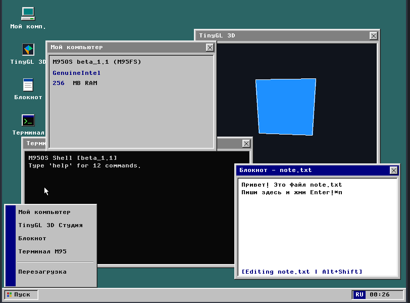

<p align="center">
  
</p>

<h1 align="center">M95OS (beta_1.1)</h1>

<p align="center">
  Легковесная 32-битная операционная система (x86 Protected Mode) с интерфейсом в стиле Windows 95/98, программным 3D-рендерингом и виртуальной файловой системой <b>M95FS</b>.
</p>

<p align="center">
  
</p>

## Возможности системы
- **Мультиязычный запуск (EN / RU):** Выбор языка при загрузке, системный шрифт `8×14` с поддержкой UTF-8 кириллицы и переключение раскладки (`Alt + Shift` или через трей).
- **Графическая оболочка:** Двойная буферизация (`800×600×32bpp`), перекрывающиеся окна с Z-порядком, меню «Пуск», панель задач и системные часы.
- **TinyGL 3D Studio:** Программный 3D-конвейер со сплошной заливкой треугольников и сортировкой граней по глубине (Painter's Algorithm).
- **M95 Shell & M95FS:** Командный интерпретатор (`help`, `ver`, `sysinfo`, `mem`, `cpu`, `ls`, `cat`, `color`, `time`, `cube`, `note`, `clear`, `reboot`) и файловая система в RAM, связанная с **Блокнотом** (`note.txt`).

## Сборка и запуск в Linux
```bash
./build.sh
qemu-system-i386 -m 256M -vga std -cdrom m95os.iso -display gtk
```
